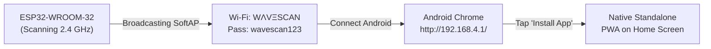

<p align="center">
  
</p>

<h1 align="center">WΛVΞSCAN</h1>

<p align="center">
  <strong>High-Performance Mobile-First 2.4 GHz Wi-Fi Analyzer for ESP32-WROOM-32 & Android</strong>
</p>

<p align="center">
  <a href="https://github.com/aryamanm77/-WaveScan/blob/main/LICENSE"></a>
  
  
  
  
  <a href="https://aryamanm77.github.io/-WaveScan/"></a>
</p>

---

## ⚡ 1-Click Web Flasher (Zero Install!)

You do **not** need to install Arduino IDE, Python, or compiler toolchains. You can connect your ESP32 board to your computer with a USB cable and flash the firmware directly through your web browser!

<p align="center">
  <br>
  <a href="https://aryamanm77.github.io/-WaveScan/">
    
  </a>
  <br><br>
  <strong>👉 <a href="https://aryamanm77.github.io/-WaveScan/">CLICK HERE TO OPEN THE WEB INSTALLER</a> 👈</strong>
  <br>
  <em>(Requires Google Chrome, Microsoft Edge, or Opera on Windows, macOS, Linux, or Android with OTG)</em>
</p>

### How to Flash via Web Browser:
1. Plug your **ESP32-WROOM-32** into your computer using a USB data cable.
2. Click the **[Web Flasher Button Above](https://aryamanm77.github.io/-WaveScan/)**.
3. Click **"Flash WΛVΞSCAN Firmware"** and select your ESP32's COM port (e.g. *CP2102* or *CH340*).
4. Wait ~30 seconds for the browser to erase and flash the firmware.
5. That's it! Your ESP32 is ready.

---

## 📱 How to Use with Android

Once flashed, the ESP32 automatically broadcasts its own standalone Wi-Fi network and hosts the mobile analyzer dashboard.



1. **Connect Wi-Fi**:
   - On your Android phone, scan for Wi-Fi and connect to:
     - **SSID**: `WΛVΞSCAN`
     - **Password**: `wavescan123`
   *(If Android warns "Wi-Fi has no internet access", tap **"Stay Connected"**).*
2. **Open Dashboard**:
   - Open **Google Chrome** and go to:
     ```text
     http://192.168.4.1/
     ```
3. **Install as App (PWA)**:
   - Tap the **"Install App"** button at the top banner, or open the Chrome menu (`⋮`) &rarr; **"Add to Home screen"** / **"Install app"**.
   - WΛVΞSCAN will install as a standalone app with its own app icon on your home screen!

---

## 🎨 Visual Interface & Signal Logic

WΛVΞSCAN is designed to replicate the classic, dense Android Wi-Fi Analyzer layout on a dark charcoal theme:

- **Background**: `#292929` dark charcoal
- **Navigation Bar**: `#20232B`
- **Text**: Primary `#EEEEEE`, Secondary `#858585`
- **6px Precision Signal Bar**: Features a smooth color gradient fill with a crisp vertical tick marker tracking the **historical best RSSI** per access point saved in browser `localStorage`.

### Signal Color Categories:
| Signal RSSI | Category | Indicator Color | Evaluation |
|---|---|---|---|
| **$\ge -65\text{ dBm}$** | **Good** | 🟢 `#00C99A` (Green) | Fast, reliable link; ideal for streaming & gaming |
| **$-66\text{ to } -75\text{ dBm}$** | **Medium** | 🟡 `#FFD600` (Yellow) | Normal indoor coverage; browsing & video |
| **$< -75\text{ dBm}$** | **Bad** | 🔴 `#E65345` (Red) | Weak signal; packet loss & high latency |

*Signal percentage calculation formula*:
$$\text{Percentage} = \text{clamp}((\text{RSSI} + 100) \times 2,\, 0,\, 100)$$

---

## 🗂 4 Comprehensive Feature Tabs

### 1. 📶 List Tab (Default View)
- Dense scrolling list of nearby 2.4 GHz access points.
- Instant search filter by SSID.
- Filters: **All**, **Secured (WPA/WPA2/WPA3)**, **Open**, **Strong ($\ge -65\text{ dBm}$)**, **Weak ($< -75\text{ dBm}$)**.
- Sorting options: Signal Strength, SSID Alphabetical, Channel Number.
- Real-time current RSSI vs. historical best RSSI tracking per BSSID.

### 2. 📊 Channels Tab (Spectrum Distribution)
- Interactive SVG parabolic curves showing 2.4 GHz channel overlap and distribution across channels 1–14 (2412–2484 MHz).
- Co-channel congestion ratings for standard non-overlapping channels (1, 6, 11).
- Channel breakdown list showing all networks broadcasting on each channel.

### 3. 🔍 Discovery Tab (Deep Inspector)
- Detailed technical breakdown of selected access point: SSID, BSSID, RSSI, Best RSSI, Channel, Frequency, Security encryption, and estimated free-space distance.
- Live sparkline telemetry graph plotting recent signal strength samples.
- Location tagging: Tag survey spots (*Living Room*, *Office*, *Server Rack*, *Garden*) stored permanently in `localStorage`.

### 4. ⚡ Diagnostics & Speed Test Tab
- Real-time ESP32 hardware status: Uptime, IP address, MAC address, Free Heap RAM, scan response latency.
- **Wi-Fi Ping Test**: Measures roundtrip packet latency between phone and ESP32.
- **Local Throughput Test**: Measures raw Wi-Fi link payload transfer speed.
- **CSV Data Export**: One-click RFC 4180 compliant CSV export (`/api/history.csv`) for site survey logging in Excel.

---

## 🛠 Manual Flashing & Compilation

If you prefer building and uploading the source code manually:

### Option A: Arduino CLI (Fastest)
```powershell
# 1. Compile firmware and export binaries
& "D:\aurd\Arduino IDE\resources\app\lib\backend\resources\arduino-cli.exe" compile --export-binaries --fqbn esp32:esp32:esp32 firmware/WAVESCAN

# 2. Upload to ESP32 on COM5
& "D:\aurd\Arduino IDE\resources\app\lib\backend\resources\arduino-cli.exe" upload -p COM5 --fqbn esp32:esp32:esp32 firmware/WAVESCAN
```

### Option B: esptool.py (Single-Command Flashing)
You can flash the pre-compiled full 4MB merged image directly using `esptool`:
```bash
pip install esptool
esptool.py --chip esp32 write_flash 0x0 bin/WAVESCAN_merged_4MB.bin
```

### Option C: Arduino IDE GUI
1. Open `firmware/WAVESCAN/WAVESCAN.ino` in Arduino IDE.
2. Select Board: **ESP32 Dev Module**.
3. Select your **Port** (e.g. `COM5`).
4. Click **Upload**.

---

## 🌐 Enabling GitHub Pages (For Repo Owner)

To enable the Web Flasher at `https://aryamanm77.github.io/-WaveScan/`:
1. Go to your repository settings on GitHub: **Settings** &rarr; **Pages**.
2. Under **Build and deployment** &rarr; **Source**, select **Deploy from a branch**.
3. Under **Branch**, select `main` and folder `/ (root)`.
4. Click **Save**.
5. Within 1 minute, your web installer will be live at:
   ```text
   https://aryamanm77.github.io/-WaveScan/
   ```

---

## 📜 REST API Reference

The ESP32 web server provides high-performance JSON endpoints:

| Method | Endpoint | Description |
|---|---|---|
| `GET` | `/` | Serves the mobile analyzer web application |
| `GET` | `/manifest.json` | Web App Manifest for Android PWA |
| `GET` | `/sw.js` | Service Worker for offline asset caching |
| `GET` | `/api/status` | System telemetry (Uptime, Heap, IP, Scan State) |
| `POST`| `/api/scan` | Initiates an asynchronous non-blocking Wi-Fi scan |
| `GET` | `/api/results` | Returns JSON array of all detected networks |
| `GET` | `/api/history` | Returns recent signal strength buffer |
| `GET` | `/api/history.csv` | Downloads RFC 4180 CSV export |
| `GET` | `/api/network?bssid=...` | Returns deep diagnostic info for target BSSID |
| `GET` | `/api/ping` | Rapid HTTP ping latency benchmark |
| `GET` | `/api/speedtest` | Transfers binary payload for local Wi-Fi throughput test |

---

## 📁 Repository Structure

```text
WAVESCAN/
├── index.html                     <-- Official Web Flasher (GitHub Pages)
├── manifest.json                  <-- ESP Web Tools Flash Manifest
├── README.md                      <-- Project documentation & Web Flash CTA
├── LICENSE                        <-- MIT License
│
├── bin/                           <-- Pre-compiled binaries for Web Flashing
│   ├── bootloader.bin             <-- Offset 0x1000 (4096)
│   ├── partitions.bin             <-- Offset 0x8000 (32768)
│   ├── boot_app0.bin              <-- Offset 0xe000 (57344)
│   ├── firmware.bin               <-- Offset 0x10000 (65536)
│   └── WAVESCAN_merged_4MB.bin    <-- Complete flash image at offset 0x0
│
├── firmware/
│   ├── WAVESCAN.ino               <-- Master ESP32 Arduino Sketch
│   ├── web_assets.h               <-- PROGMEM embedded web bundle fallback
│   └── WAVESCAN/
│       ├── WAVESCAN.ino           <-- Arduino IDE sketch folder
│       └── web_assets.h
│
├── data/                          <-- Mobile-first analyzer frontend
│   ├── index.html                 <-- Analyzer web interface
│   ├── style.css                  <-- Classic charcoal dark theme
│   ├── app.js                     <-- High-performance vanilla JS engine
│   ├── manifest.json              <-- PWA Manifest
│   ├── sw.js                      <-- PWA Service Worker
│   └── icons/
│       ├── icon.svg               <-- Vector icon
│       ├── icon-192.png           <-- 192px PWA icon
│       └── icon-512.png           <-- 512px PWA splash icon
│
└── docs/
    ├── INSTALLATION.md            <-- Step-by-step flashing guide
    ├── WIRING.md                  <-- Zero-budget hardware guide
    └── TROUBLESHOOTING.md         <-- Troubleshooting & driver guide
```

---

## ⚖️ License
Released under the [MIT License](LICENSE).
Built with ❤️ for the open-source ESP32 & maker community.
